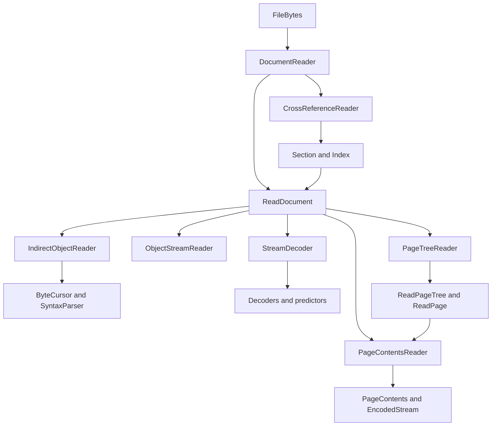

# Reader architecture

English | [Français](fr/architecture.md)

Version 0.2 accepts PDF 1.0–1.7 and PDF 2.0 headers and catalog versions.
The shared syntax and object-stream pipeline exposes the source dictionaries;
semantic interpretation of tagging, fonts or metadata belongs to optional layers.
Encrypted inputs and unsupported filters remain explicitly rejected.

The reader transforms PDF bytes into a browsable object graph. It retains
references as explicit values and uses primitives from
[PDFToolkit/pdf](https://github.com/PDFToolkit/pdf). The reference clauses are
ISO 32000-1, 7.2–7.5 for structure and 7.7.3 for pages; the standard PDF remains
in the model repository.

## Two packages and one dependency

`roukmoute/pdf` defines primitives and their writing. `pdftoolkit/pdf-reader`
adds reading mechanisms under `PDF\Reading`. Composer connects the reader to
the model; there is no reverse dependency from the writer to the reader.

A parsed string becomes a `StringType`, a name a `NameType`, an array an
`ArrayType`, and a dictionary a `DictionaryType`. Objects are not transformed
into application associative arrays or JSON strings. PDF strings remain bytes;
text interpretation belongs to layers that know the context and encoding.

Two types belong to the source document: `ObjectReference` identifies an object
without carrying its target, and `EncodedStream` retains a dictionary and its
encoded bytes. They implement `BasicType` so they can be used in the same
arrays and dictionaries. Their `toPdf()` throws an exception: an import must
rebuild references in the destination document before writing can be correct.
No import bridge is implemented yet.

## Reading pipeline

`DocumentReader` checks the header and final footer, reads the `/Prev` revision
chain and assembles the effective index. It traverses sections from newest to
oldest. A newer entry overrides earlier entries, including when it marks an
object as free. The effective trailer also retains the newest values.
The catalog is resolved and checked before `read()` returns the document.

`CrossReferenceReader` reads traditional tables or xref streams. An xref
stream's structural fields must be direct: no resolver is available yet during
index construction. Ranges are bounded, generations are checked and binary
fields are read in big-endian order without integer overflow. Hybrid sections
and encryption are rejected.

`ReadDocument` owns the source, index, limits and caches. It loads an object
on demand, checks that its identifier matches the xref entry, then retains the
same instance for later accesses. A missing, free or different-generation
reference returns a `NullType`. Normal graph cycles such as `/Parent` and
`/Kids` remain references; resolving an object does not automatically traverse
its neighbours.

An identifier is local to its file. Resolve a reference using the `ReadDocument`
it came from; the same number/generation pair may identify a different object
in another document.

`ByteCursor` provides a bounded view of a byte string with absolute positions.
`SyntaxParser` reads a syntax value without resolving references. Structural
readers then add the meaning of `obj`, `endobj`, `stream` and dictionary entries.
`/Length` determines the stream's binary extent: an `endstream` marker inside
its data remains data.

`ObjectStreamReader` checks `/N`, `/First` and number/offset pairs. Each member
is parsed in its own bounded view, then its number is compared with the xref
entry identifying it. The container and its members have generation zero;
a member cannot be a stream or a simple reference. `/Extends` describes a
collection of streams and does not trigger an automatic search in another
container.

## Explicit resolution and decoding

`ReadDocument::resolve()` performs one operation: resolve a reference or
preserve a direct value. The `ObjectResolver` interface lets readers that
need this service, notably for `/Length` and filter parameters, receive it
through construction or an argument.

`EncodedStream::encodedBytes()` retains the original bytes.
`ReadDocument::streamData()` triggers decoding and retains the result in a
document-scoped cache. `StreamDecoder` reads `/Filter` and `/DecodeParms`,
applies the chain in PDF order, then predictors when present. Filters are
separate, composable, testable objects.

Caches, cursors and counters are mutable because they represent an ongoing
read. Identifiers, references, sections and limits are immutable values.
No singleton, global state, static factory or service hidden in a value object
is needed.

## Pages as source document objects

`PageTreeReader` receives a `ReadDocument` and its `PageTreeLimits`. A `read()`
request creates traversal state in `PageTreeTraversal`. A `PageTreeFrame` stack
follows children in `/Kids` order and counts each branch's leaves on return.
Previously visited references allow cycles and repeated descendants to be
rejected; `/Parent` entries must match the parents actually traversed.
The reader returns a `ReadPageTree` only after checking the entire tree's counts.

`PageAttributeReader` resolves the four inheritable entries using `ReadDocument`
as its `ObjectResolver`. It produces partial `PageInheritance` values down to
the leaf, where defaults become effective. This distinction prevents a default
CropBox from being fixed to an ancestor's MediaBox when a page overrides that
MediaBox lower in the tree. Resources are selected as a complete dictionary,
without merging.

A `ReadPage` retains the document that owns its reference, its source dictionary
and its effective `PageAttributes`. The latter retain PDF objects, including
the raw rotation integer. Normalising orientation is a separate request;
it does not rewrite source values.

`PageContentsReader` composes this service with a per-page stream limit. It
resolves the local `/Contents` entry in the owning document and returns an
ordered `PageContents` collection of `EncodedStream` values. It does not
inherit this entry, concatenate streams or execute filters. Decoding remains
a request to `ReadDocument::streamData()`, which uses its caches and budgets.
The [page guide](pages.md) explains this composition using independent fixtures.

## Budgets and boundaries

`ReaderLimits` describes ceilings. A `ReadBudget`, created for each
`DocumentReader::read()` call, adds up parsed values, xref entries, retained
bytes and bytes produced by decoding stages. Ceilings are shared by readers
of the same document; they do not restart at zero for each reference or filter.

The library receives `FileBytes`. The application selects the file, authorises
reading, bounds loading and manages resources. JavaScript, URI and launch
actions remain dictionaries; the library does not execute them. An external
stream is never loaded from `/F`.

This stage provides syntax, structural resolution and page traversal. Future
importers, content interpreters and form engines can compose them without
adding those responsibilities to the parser.

[Components](components.md) · [Security](security.md) · [README](../README.md)
