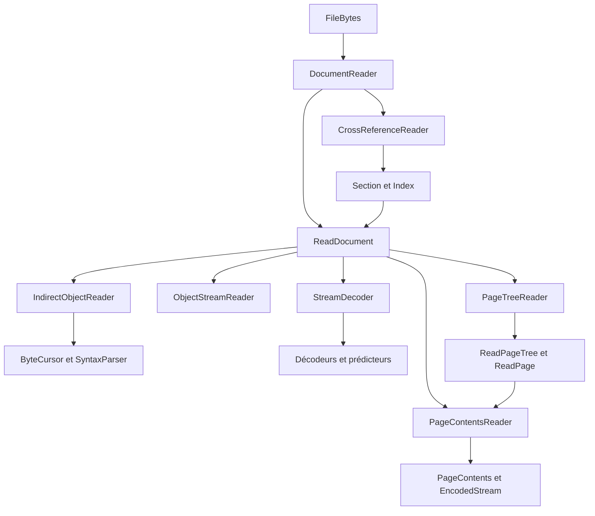

# Architecture du lecteur

[English](../architecture.md) | Français

La version 0.3 accepte les headers et versions de catalogue PDF 1.0–1.7 et 2.0.
Le même pipeline syntaxique et de flux d’objets expose les dictionnaires source ;
l’interprétation du balisage, des polices ou des métadonnées appartient aux couches
optionnelles. Les filtres non pris en charge restent refusés ; Standard et Adobe.PubSec
sont activés par des capacités explicites ([mots de passe](authentication.md),
[certificats](public-key-authentication.md)).

Le lecteur transforme des octets PDF en un graphe consultable d'objets. Il
conserve les références comme des valeurs explicites et utilise les primitives
de [PDFToolkit/pdf](https://github.com/PDFToolkit/pdf). Les clauses de référence
sont ISO 32000-1, 7.2–7.5 pour la structure et 7.7.3 pour les pages ; le PDF
de norme reste dans le dépôt du modèle.

## Deux paquets et une dépendance

`roukmoute/pdf` définit les primitives et leur écriture. `pdftoolkit/pdf-reader`
ajoute les mécanismes de lecture sous `PDF\Reading`. Composer relie le lecteur
au modèle ; aucune dépendance inverse ne relie le writer au lecteur.

Une chaîne lue devient un `StringType`, un nom un `NameType`, un tableau un
`ArrayType`, un dictionnaire un `DictionaryType`. Les objets ne sont pas
transformés en tableaux associatifs applicatifs ni en chaînes JSON. Les chaînes
PDF restent des octets ; leur interprétation textuelle appartient aux couches
qui connaissent le contexte et l'encodage.

Deux types appartiennent au document source : `ObjectReference` identifie un
objet sans porter sa cible, et `EncodedStream` conserve un dictionnaire avec
ses octets encodés. Ils implémentent `BasicType` pour rester utilisables dans
les mêmes tableaux et dictionnaires. Leur `toPdf()` lève une exception : un
import doit reconstruire les références du document destinataire avant que
l'écriture puisse être correcte. Aucun pont d'import n'est encore implémenté.

## Pipeline de lecture

`DocumentReader` contrôle le header et le dernier footer, lit la chaîne de
révisions `/Prev` et assemble l'index effectif. Il parcourt les sections de la
plus récente à la plus ancienne. Une entrée récente masque les anciennes,
y compris lorsqu'elle marque un objet comme libre. Le trailer effectif conserve
également les valeurs les plus récentes. Le catalogue est résolu et contrôlé
avant que `read()` ne retourne le document.

`CrossReferenceReader` lit les tables traditionnelles ou les flux xref. Les
champs structuraux d'un flux xref doivent être directs : aucun résolveur n'est
encore disponible pendant la construction de l'index. Les plages sont bornées,
les générations contrôlées et les champs binaires lus en big endian sans
dépassement d'entier. Les sections hybrides appliquent la priorité du flux `/XRefStm` sur la table
associée, tout en conservant le `/Prev` de celle-ci.

`ReadDocument` possède la source, l'index, les limites et les caches. Il charge
un objet à la demande, vérifie que son identifiant correspond à l'entrée xref,
puis conserve la même instance pour les accès suivants. Une référence absente,
libre ou de génération différente retourne un `NullType`. Les cycles normaux
du graphe, comme `/Parent` et `/Kids`, restent des références ; la résolution
d'un objet ne parcourt pas automatiquement ses voisins.

Un identifiant est local à son fichier. Il faut résoudre une référence avec le
`ReadDocument` dont elle provient ; la même paire numéro/génération peut désigner
un autre objet dans un autre document.

`ByteCursor` offre une vue bornée d'une chaîne d'octets avec positions absolues.
`SyntaxParser` lit une valeur syntaxique sans résoudre ses références. Les
lecteurs structuraux ajoutent ensuite le sens de `obj`, `endobj`, `stream` et
des entrées de dictionnaire. `/Length` détermine l'étendue binaire du flux :
un marqueur `endstream` dans ses données reste une donnée.

`ObjectStreamReader` contrôle `/N`, `/First` et les couples numéro/offset.
Chaque membre est analysé dans sa propre vue bornée, puis son numéro est
comparé à l'entrée xref qui le désigne. Le conteneur et les membres ont une
génération zéro ; un membre ne peut pas être un stream ni une simple référence.
`/Extends` décrit une collection de flux et ne déclenche pas de recherche
automatique dans un autre conteneur.

## Résolution et décodage explicites

`ReadDocument::resolve()` effectue une seule opération : résoudre une référence
ou conserver une valeur directe. L'interface `ObjectResolver` permet aux
lecteurs qui en ont besoin, notamment pour `/Length` et les paramètres de
filtres, de recevoir ce service par construction ou par argument.

`EncodedStream::encodedBytes()` fournit les octets prêts pour les codecs ;
`originalEncodedBytes()` conserve les octets source, chiffrés le cas échéant.
`ReadDocument::streamData()` déclenche le décodage et garde le résultat dans
un cache propre au document. `StreamDecoder` lit `/Filter` et `/DecodeParms`,
applique la chaîne dans l'ordre du PDF, puis les prédicteurs lorsque présents.
Les filtres sont des objets séparés, composables et testables.

Les caches, curseurs et compteurs sont mutables parce qu'ils représentent une
lecture en cours. Les identifiants, références, sections et limites sont des
valeurs immuables. Aucun singleton, état global, fabrique statique ou service
caché dans un objet de valeur n'est nécessaire.

## Pages comme objets du document source

`PageTreeReader` reçoit un `ReadDocument` et ses `PageTreeLimits`. Une demande
`read()` crée son état de parcours dans `PageTreeTraversal`. Une pile de
`PageTreeFrame` suit les enfants dans l'ordre de `/Kids` et compte les feuilles
de chaque branche au retour. Les références déjà visitées permettent de refuser
les cycles et les descendants répétés ; les `/Parent` doivent correspondre aux
parents réellement parcourus. Le lecteur rend un `ReadPageTree` seulement après
la vérification des comptes de l'arbre entier.

`PageAttributeReader` résout les quatre entrées héritables en utilisant
`ReadDocument` comme `ObjectResolver`. Il produit des `PageInheritance`
partiels jusqu'à la feuille, où les valeurs par défaut deviennent effectives.
Cette distinction évite de figer un CropBox par défaut sur le MediaBox d'un
ancêtre si une page remplace ce MediaBox plus bas dans l'arbre.
Les ressources sont choisies comme un dictionnaire entier, sans fusion.

Un `ReadPage` conserve le document qui possède sa référence, son dictionnaire
source et ses `PageAttributes` effectifs. Ces derniers gardent des objets PDF,
dont l'entier de rotation brut. La normalisation de l'orientation est une
demande distincte ; elle ne réécrit pas les valeurs de la source.

`PageContentsReader` compose ce service avec une limite de flux par page. Il
résout l'entrée locale `/Contents` dans le document propriétaire et retourne
un `PageContents` ordonné d'`EncodedStream`. Il n'hérite pas cette entrée,
ne concatène pas les flux et n'exécute pas les filtres. Le décodage reste
une demande à `ReadDocument::streamData()`, qui utilise ses caches et budgets.
Le [guide des pages](pages.md) explique cet assemblage avec les fixtures
indépendantes.

## Budgets et frontières

Un `ReaderLimits` décrit les plafonds. Un `ReadBudget`, créé pour chaque appel
à `DocumentReader::read()`, additionne les valeurs analysées, les entrées xref,
les octets conservés et les octets produits par les étapes de décodage.
Les plafonds sont partagés par les lecteurs du même document ; ils ne repartent
pas de zéro à chaque
référence ou filtre.

La bibliothèque reçoit des `FileBytes`. L'application choisit le fichier,
autorise sa lecture, borne son chargement et gère ses ressources. Les actions
JavaScript, URI ou de lancement restent des dictionnaires ; la bibliothèque
ne les exécute pas. Un flux externe n'est jamais chargé depuis `/F`.

Cette étape fournit la syntaxe, la résolution structurelle et le parcours de
pages. Les futurs imports, interpréteurs de contenu et moteurs de formulaire
pourront les composer sans ajouter ces responsabilités au parseur.

[Composants](components.md) · [Sécurité](security.md) · [README](../../README.fr.md)

Après authentification, les chaînes et flux sont déchiffrés une seule fois
dans le document qui possède la clé. `originalEncodedBytes()` conserve le
ciphertext ; `encodedBytes()` fournit les octets prêts pour les codecs.

## Provenance de l’intégrité source

`ReadDocument::resolve()` suit les chaînes de références indirectes physiques
sous la limite de profondeur du document, détecte les cycles par numéro et
génération et conserve les références indisponibles comme null PDF.
ISO 32000-2:2020, 7.3.10 (page physique 49), autorise ces chaînes hors des flux
d’objets ; un membre compressé constitué uniquement d’une référence reste refusé.

L’authentification reçoit le graphe brut avant la création du graphe déchiffré.
`SourceRevision` conserve le dernier trailer physique séparément du trailer
effectif hérité. Les étendues de chaînes établies par le parseur identifient le
véritable jeton MAC ou Contents ; les tranches de flux d’objets ne peuvent pas
inventer de positions dans le fichier original. Le vérificateur lie ces octets
chiffrés exacts à la clé de fichier authentifiée avant l’interprétation du
catalogue. Le résultat reste dans le contexte de déchiffrement immuable.
`SourceIntegrityPolicy::RequirePdfMac` refuse aussi une source sans indice MAC.
Cette politique ne valide pas la confiance dans une signature numérique :
consulter le [contrat MAC borné](source-mac.md).

## Historique physique distinct

`RevisionHistoryReader` conserve chaque section et son footer vérifié, puis construit
un graphe brut borné au préfixe de chaque révision. Toutes les vues partagent un
budget ; le choix d’un préfixe authentifié reste un appel explicite séparé à `read()`.
Les objets après un flux xref sont délimités par leurs véritables étendues indexées.
Le [guide des révisions](revision-history.md) décrit le contrat sans autorité
cryptographique et les limites explicites des structures linéarisées.
